
 


 


 

<a href="https://georgederick.github.io/Conecta-Tech/"></a>

 

<a href="https://georgederick.github.io/atlas-mundi/"></a>

 

<a href="https://georgederick.github.io/the-golden-pig/"></a>

 

<a href="https://georgederick.github.io/Flua/"></a>

 

<a href="https://georgederick.github.io/windows-xp-/"></a>

 

<a href="https://georgederick.github.io/apex-telemetry"></a>

 

 

name: generate pacman contribution graph

on:
  schedule:
    - cron: "0 */12 * * *"   # atualiza a cada 12 horas
  workflow_dispatch:          # permite rodar manualmente
  push:
    branches:
      - main

permissions:
  contents: write

jobs:
  generate:
    runs-on: ubuntu-latest
    timeout-minutes: 5
    steps:
      - name: Generate pacman-contribution-graph.svg
        uses: abozanona/pacman-contribution-graph@main
        with:
          github_user_name: ${{ github.repository_owner }}

      - name: Push SVGs to the output branch
        run: |
          cd dist
          git init -b output
          git config user.name "github-actions[bot]"
          git config user.email "41898282+github-actions[bot]@users.noreply.github.com"
          git add .
          git commit -m "chore: update pacman contribution graph"
          git remote add origin "https://x-access-token:${{ secrets.GITHUB_TOKEN }}@github.com/${{ github.repository }}.git"
          git push -f origin output

<!-- Se quiser manter o seu Pac-Man de contribuições, cole o bloco dele aqui -->

 

  <a href="mailto:georgederickk@gmail.com"></a>
  <a href="tel:+5511953706785"></a>
  <a href="https://www.linkedin.com/in/georgederick/"></a>
  <a href="https://github.com/georgederick"></a>
  

  

